     

  

 I'm a <b>Computer Science</b> student at <b>CESAR School</b> 🎓. I love learning, exploring new technologies and using them to solve real-world problems ✨. I'm currently focused on <b>Software Engineering | Physical Robotics</b> 🌐 and on improving my skills in programming languages like <b>Python</b> 🧠. 
  
      
  
   
 
  
 
  
  
   
  

